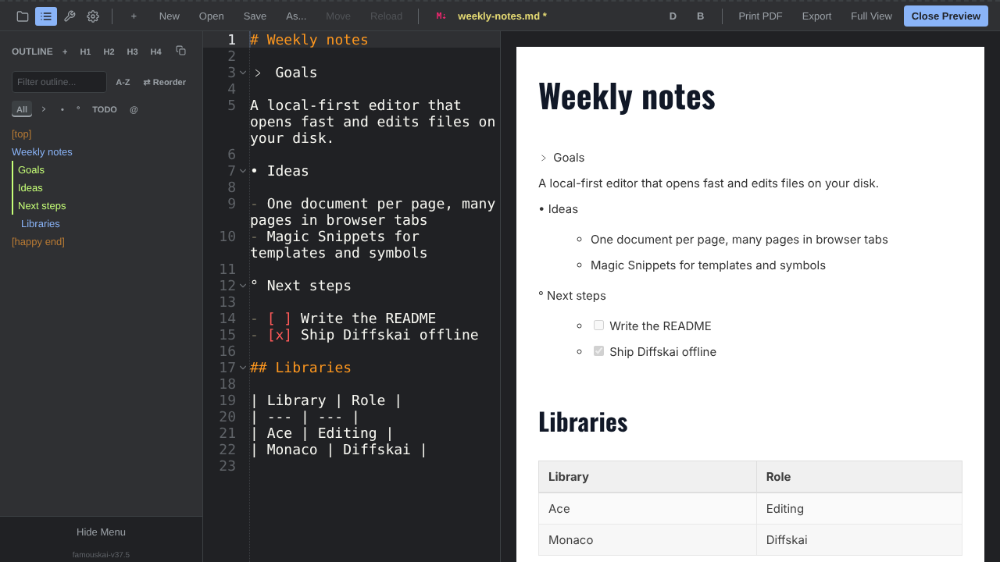

# Famouskai Editor 🦊

*Read this in other languages: [Français](README.fr.md)*

Famouskai is a "Local-First" code and text editor built as a Progressive Web App (PWA). Designed for speed, privacy and resilience, it opens in a second, edits the files on your disk directly, and runs entirely in your browser: no account, no backend, no remote database, no build step.

**What Famouskai will always be, and never be: [DNA.md](./DNA.md).**

Think of it as a reliable, editable post-it for your files rather than a heavyweight IDE. Coupled with **Diffskai**, its built-in comparison and merge tool, Famouskai makes sure your local edits are never silently overwritten when another program changes the same file.

**Supported browsers:** desktop Chromium browsers (Chrome, Edge). Firefox and Safari can display the editor but cannot open or save files, because they do not implement the File System Access API.

**Find the creator and other projects at: [github.com/denys-digital](https://github.com/denys-digital)**



## Quick start

- **Try it online:** open [app.famouskai.com](https://app.famouskai.com) in Chrome or Edge, then use **Open** to edit a file from your disk. To install it as an app, use the install icon in the address bar.
- **Run it from a copy of this repository:** download the ZIP (green **Code** button, then **Download ZIP**), unzip it, and double-click `index.html`. There is nothing to install or build. Offline mode needs the app to be served over HTTPS or `localhost` (see *Known limitations*).

## How it works

- **One document per page.** Famouskai deliberately has no internal tab system: your browser already has one. Need a second file? Open a new window or browser tab (the **+** button, or Ctrl+click a file in the Explorer) and keep as many editors side by side as you like.
- **Your files stay on your disk.** Files are read and written in place through the File System Access API. Famouskai only keeps preferences, recent files and your snippets in the browser's local storage.
- **Diffskai protects your work.** If another program changed the file on disk since you opened it, Famouskai stops before saving and offers to open Diffskai, a side-by-side comparison and merge view, so you decide what to keep instead of losing either version. You can also open Diffskai at any time to compare the current text with another version (the **D** button).
- **Easy to personalize.** No complex plugin ecosystem: colors live in plain CSS files, Magic Snippets insert your own templates and symbols, and tools are small JavaScript files you can read and write in an afternoon (see [`docs/PLUGIN-ARCHITECTURE.md`](./docs/PLUGIN-ARCHITECTURE.md)).

## Core Features

*   **Local & offline-ready:** direct read and write to your disk; the app itself is cached by a Service Worker and keeps working without a network once loaded.
*   **Syntax coloring** for CSS, CSV, Diff/Patch, HTML, JavaScript/TypeScript, JSON, Markdown, SVG, XML, YAML, `.log` and plain text.
*   **Markdown preview:** live, sanitized preview side by side with the editor, single-file HTML export and Print to PDF.
*   **Tabbed sidebar:** Explorer (workspaces and files), Outline (document structure), Tools and Magic Snippets, Windows & Settings.
*   **Famous Marks:** three markers (`﹥` Famous Arrow, `•` Magic Dot, `°` Flying Bubble) that turn any comment or line into a foldable section listed in the Outline. See [`docs/FAMOUS-MARK.md`](./docs/FAMOUS-MARK.md).
*   **Built-in tools:** Beautify, Tidy & Sanitize Text, Sort Lines, Remove Duplicate Lines, Extract & Copy Table, and more.
*   **PWA:** installable on Windows, macOS, Linux and ChromeOS; once installed, it can open files straight from your file manager.

## Known limitations

- **Desktop Chromium only** for opening and saving files. Other browsers show a banner explaining this; there is no upload/download fallback yet.
- **Offline mode needs HTTP(S).** A Service Worker cannot run from `file://`, so a copy opened by double-clicking `index.html` works, but only while its files are reachable. Serve the folder over HTTPS or `localhost` for offline use.
- **Host it at the root of a domain.** The Service Worker and the manifest use absolute paths, so a sub-folder deployment (such as a GitHub Pages project site) breaks offline mode.
- **Diffskai offline:** its engine (Monaco Editor) is cached in the background after the first visit; open Diffskai once while online to be sure it is available offline. Monaco is pinned at 0.56.0 for this release.

## Built With (Zero-CDN Architecture)

Famouskai is built to be resilient. To guarantee true offline capability, **all dependencies are vendored locally** (no CDN calls). See [`THIRD-PARTY-NOTICES.md`](./THIRD-PARTY-NOTICES.md) for legal details.

| Library | Version | Role | License |
| --- | --- | --- | --- |
| **[Ace Editor](https://github.com/ajaxorg/ace)** | 1.44.0 | Core text editing engine | BSD-3-Clause |
| **[Diff2Html](https://github.com/rtfpessoa/diff2html)** | 3.4.56 | Read-only pretty rendering of .patch/.diff files in the Preview pane | MIT |
| **[DOMPurify](https://github.com/cure53/DOMPurify)** | 3.4.17 | Sanitizes the rendered Markdown preview and HTML export | MPL-2.0 OR Apache-2.0 |
| **[idb-keyval](https://github.com/jakearchibald/idb-keyval)** | 6.3.0 | Promise-based IndexedDB storage | Apache-2.0 |
| **[js-beautify](https://github.com/beautifier/js-beautify)** | 2.0.3 | Code formatting and indentation tools | MIT |
| **[Marked](https://github.com/markedjs/marked)** | 18.1.1 | Ultra-fast Markdown parser for live preview | MIT |
| **[Monaco Editor](https://github.com/microsoft/monaco-editor)** | 0.56.0 | Diff/Merge resolution engine (Diffskai) | MIT |
| **[Oswald (Fontsource)](https://github.com/googlefonts/OswaldFont)** | 5.3.0 | Headings font of the Markdown preview themes (weights 500 and 700, latin subset) | OFL-1.1 |

## License & Usage (Dual License)

Famouskai is passionately developed under a **Dual License** model to guarantee its open evolution while ensuring long-term sustainability.

**1. Open Source (AGPLv3)**
You are free to use, modify, and distribute Famouskai for personal, academic, or open-source projects, provided you share your modifications under the exact same license (AGPLv3). Openness breeds openness. Full text: [`LICENSE`](./LICENSE).

**2. Commercial License**
Want to integrate Famouskai into your proprietary product (SaaS, closed CMS, internal corporate tool) without open-sourcing your own codebase? See [`docs/COMMERCIAL-LICENSE.md`](./docs/COMMERCIAL-LICENSE.md) for details, or contact me directly to acquire an affordable commercial license tailored to your needs.

## Sponsorship & Support

If Famouskai saves you time, or if Diffskai has saved your files from a fatal overwrite, please consider supporting the project!

Any form of sponsorship helps me maintain the tool, pay for demo hosting, and build new features without ever relying on ad trackers or external investors.

🡪 **[Support Famouskai on Ko-fi](https://ko-fi.com/denysdigital)**

## Repository Structure

This repository keeps its root focused on **code only**. Every governance and process file lives
in one of two well-known folders, both auto-detected by GitHub:

```
famouskai/
├── index.html, sw.js, manifest.json, *.css      ← the app itself (no build step)
├── plugins/                                     ← extensions (ext-*.js) and tools (tool-*.js)
├── vendor/                                      ← local copies of every library (no CDN)
├── tests/                                       ← manual-*.md test plans, unit-*.html test pages, fixtures-* sample files
├── CHANGELOG.md                                 ← version history (release-adjacent, kept at root)
├── LICENSE                                      ← full AGPLv3 text (must stay at root)
├── THIRD-PARTY-NOTICES.md                       ← vendors licenses (must stay at root)
├── DNA.md                                       ← what Famouskai will always be, and never be
├── README.md / README.fr.md
├── docs/                                        ← everything a human reads, not GitHub-"magic"
│   ├── 00-START-HERE-HOW-TO.md                  ← start here if you want to contribute
│   ├── BRAND-GUIDE.md, brand-*.svg              ← logo, colors and visual rules
│   ├── PLUGIN-ARCHITECTURE.md                   ← how to write a tool or an extension
│   ├── FAMOUS-MARK.md, SIDEBAR-ARCHITECTURE.md  ← how Famous Marks and the sidebar work
│   ├── ROADMAP.md                               ← what comes after 0.1.0
│   ├── CLA.md                                   ← Contributor License Agreement
│   ├── COMMERCIAL-LICENSE.md
│   └── MAINTAINER-GUIDE.md
└── .github/                                     ← everything GitHub reads automatically
    ├── CODE_OF_CONDUCT.md, CONTRIBUTING.md, FUNDING.yml
    ├── PULL_REQUEST_TEMPLATE.md, SECURITY.md
    ├── ISSUE_TEMPLATE/bug_report.md, config.yml, feature_request.md
    └── workflows/cla.yml
```

**Why split this way?** `.github/` holds files GitHub itself detects and acts on (issue/PR
templates, the Sponsor button, the CLA bot); they only work if placed exactly there or at the
root. `docs/` holds everything meant for humans, not for GitHub's automation. Splitting the two
keeps the repository root free for what actually matters when browsing the code: the code itself.

New here? Start with [`docs/00-START-HERE-HOW-TO.md`](./docs/00-START-HERE-HOW-TO.md), a step-by-step guide
that assumes zero prior GitHub experience, including a no-install/browser-only path for anyone
who (like the maintainer) doesn't want to set up a local Git command-line interface (CLI).

## Contributing

Contributions are highly appreciated! Whether it's fixing a bug, improving documentation, or proposing a feature, feel free to open an *Issue* or a *Pull Request (PR)*.

Before your first PR, please read:
- [`.github/CONTRIBUTING.md`](./.github/CONTRIBUTING.md): how contributions work here.
- [`docs/BRAND-GUIDE.md`](./docs/BRAND-GUIDE.md): the visual rules for anything pushed to this repository.
- [`.github/CODE_OF_CONDUCT.md`](./.github/CODE_OF_CONDUCT.md): expected behavior in this community.
- [`docs/00-START-HERE-HOW-TO.md`](./docs/00-START-HERE-HOW-TO.md): a complete, beginner-friendly walkthrough (Fork → Pull Request), including a browser-only path if you'd rather not install anything locally.

Your first Pull Request will trigger an automated bot asking you to sign the lightweight
[Contributor License Agreement](./docs/CLA.md) (CLA), a one-time, one-click step.
