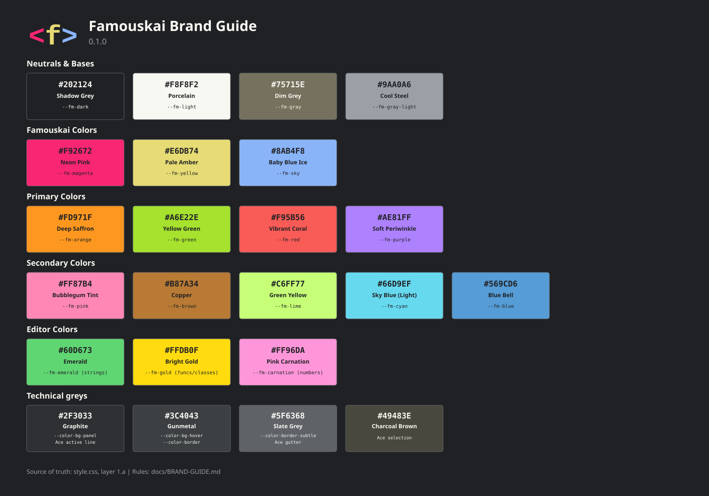

# Famouskai Brand Guide

This document defines the visual identity of Famouskai for the 0.1.0 public release.

---

## 1. Scope

This guide defines the official visual identity for anything pushed to the public repository (`github.com/denys-digital/famouskai`).

Contributors may theme or customize the application locally as they see fit. However, all contributions submitted for inclusion in the official repository must strictly adhere to the rules in this document.

**Source of truth:** `style.css`, layer 1.a (Design Tokens). If this guide and `style.css` disagree, `style.css` wins and this document is updated.

Famouskai is strictly local-first and zero-CDN (see [`../DNA.md`](../DNA.md)): no hosted font, external stylesheet, or CDN image may ever be introduced.

---

## 2. Logo

The Famouskai logo consists of the prompt mark `< f >` rendered in Cousine Bold on a circular disc:
- `<` symbol: Neon Pink (`--fm-magenta` / `#F92672`)
- `f` letter: Pale Amber (`--fm-yellow` / `#E6DB74`)
- `>` symbol: Baby Blue Ice (`--fm-sky` / `#8AB4F8`)
- Circular background disc: Shadow Grey (`--fm-dark` / `#202124`)

The logo exists in two vector files:
- `icon.svg`: The live application icon loaded by the app (uses standard Cousine font text).
- `docs/brand-logo-outlined.svg`: Outlined version with text converted to vector paths (SIL OFL 1.1). Use this file for documentation, slides, READMEs, and web display where Cousine is not installed.

### Logo Rules
- **Clear Space:** Maintain a safety area of at least 10% of the disc diameter around the logo.
- **Minimum Size:** 16 px in UI, 32 px in documentation.
- **Do not:** recolor any element, stretch or distort proportions, replace the Cousine font, remove the dark disc, or add drop shadows, outer glows, or gradients.
- **Naming:** The project name is **Famouskai** (one word, capital F). Related names are **Diffskai** and **Famous Marks**.

---

## 3. Palette

The Famouskai visual identity uses 19 brand tokens (`--fm-*`) and 4 technical greys. Contrast ratios are measured against the `--fm-dark` background (`#202124`).

### 1. Neutrals & Bases

| Token | Hex | Display Name | Contrast |
| --- | --- | --- | --- |
| `--fm-dark` | `#202124` | Shadow Grey | background |
| `--fm-light` | `#F8F8F2` | Porcelain | 15.1 |
| `--fm-gray` | `#75715E` | Dim Grey | 3.3 |
| `--fm-gray-light` | `#9AA0A6` | Cool Steel | 6.1 |

### 2. Famouskai Colors

| Token | Hex | Display Name | Contrast |
| --- | --- | --- | --- |
| `--fm-magenta` | `#F92672` | Neon Pink | 4.3 |
| `--fm-yellow` | `#E6DB74` | Pale Amber | 11.3 |
| `--fm-sky` | `#8AB4F8` | Baby Blue Ice | 7.6 |

### 3. Primary Colors

| Token | Hex | Display Name | Contrast |
| --- | --- | --- | --- |
| `--fm-orange` | `#FD971F` | Deep Saffron | 7.4 |
| `--fm-green` | `#A6E22E` | Yellow Green | 10.4 |
| `--fm-red` | `#F95B56` | Vibrant Coral | 5.1 |
| `--fm-purple` | `#AE81FF` | Soft Periwinkle | 5.7 |

### 4. Secondary Colors

| Token | Hex | Display Name | Contrast |
| --- | --- | --- | --- |
| `--fm-pink` | `#FF87B4` | Bubblegum Tint | 7.2 |
| `--fm-brown` | `#B87A34` | Copper | 4.5 |
| `--fm-lime` | `#C6FF77` | Green Yellow | 13.8 |
| `--fm-cyan` | `#66D9EF` | Sky Blue (Light) | 9.8 |
| `--fm-blue` | `#569CD6` | Blue Bell | 5.5 |

### 5. Editor Colors

| Token | Hex | Display Name | Contrast | Ace Usage |
| --- | --- | --- | --- | --- |
| `--fm-emerald` | `#60D673` | Emerald | 8.7 | strings |
| `--fm-gold` | `#FFDB0F` | Bright Gold | 11.8 | functions, classes |
| `--fm-carnation` | `#FF96DA` | Pink Carnation | 8.2 | numbers, constants |

*Note: the Ace editor theme also uses `--fm-purple` (keywords, tags), `--fm-red` (variables), `--fm-light` (main text) and `--fm-gray-light` (fallback comments).*

### 6. Technical Greys

| Hex | Display Name | Usage |
| --- | --- | --- |
| `#2F3033` | Graphite | `--color-bg-panel`, Ace active line |
| `#3C4043` | Gunmetal | `--color-bg-hover`, `--color-border` |
| `#5F6368` | Slate Grey | `--color-border-subtle`, `--color-text-disabled`, Ace gutter |
| `#49483E` | Charcoal Brown | Ace selection |

*Note: `--color-text-secondary` (`#9AA0A6`) uses `--fm-gray-light`.*

Note: "Neon Pink" is `--fm-magenta`; `--fm-pink` is "Bubblegum Tint". The 19 `--fm-*` brand tokens are mirrored in `syntax-themes.css` and must stay identical across files.

---

## 4. Colors by Usage

When writing CSS, **tokens are named by USAGE, not by hue**. Never hardcode a hex value in UI rules and rarely reference an `--fm-*` token directly in functional classes.

### Surface, Border & Text Tokens

| Usage Token | Maps To | Purpose |
| --- | --- | --- |
| `--color-bg-app` | `--fm-dark` (`#202124`) | Main background |
| `--color-bg-panel` | `#2F3033` | Panel, header, and toolbar backgrounds |
| `--color-bg-hover` | `#3C4043` | Hover states |
| `--color-border` | `#3C4043` | Standard borders |
| `--color-border-subtle` | `#5F6368` | Subtle dividers and scrollbars |
| `--color-text-primary` | `--fm-light` (`#F8F8F2`) | Body UI text |
| `--color-text-secondary` | `#9AA0A6` | Labels and secondary UI text |
| `--color-text-disabled` | `#5F6368` | Disabled text and empty states |
| `--color-accent` | `--fm-sky` (`#8AB4F8`) | Primary interactive accent |

### Status Tokens

| Usage Token | Maps To | Role |
| --- | --- | --- |
| `--color-status-error` | `--fm-red` | Errors |
| `--color-status-warn` | `--fm-orange` | Warnings |
| `--color-status-modified` | `--fm-yellow` | Modified / unsaved state |
| `--color-status-success` | `--fm-green` | Successful sync / action |
| `--color-status-conflict` | `--fm-magenta` | Diffskai merge / conflict |
| `--color-status-readonly` | `--fm-purple` | Read-only disk contents |

### Sidebar Tabs & Badges

- **Sidebar Tabs:** Explorer (`--fm-sky`), Outline (`--fm-green`), Tools (`--fm-orange`), Settings (`--fm-purple`).
- **File Type Badges:** Explorer badges use `--color-filetype-*` tokens defined in `style.css` layer 1.a.

To add a new brand color, request a new `--fm-*` token in `style.css` layer 1.a from the maintainer. To add a new UI element, create a new `--color-*` token pointing to an existing `--fm-*` token.

---

## 5. Accessibility

- **Body Text Contrast:** Main UI text (`--color-text-primary` / `--fm-light`) must meet WCAG AA contrast (at least 4.5:1 against background).
- **Low Contrast Tokens:** `--fm-magenta` (4.3), `--fm-gray` (3.3), and technical greys `#2F3033`, `#3C4043`, `#5F6368`, `#49483E` are below the 4.5:1 threshold for small text. Use them only for accents, icons, large text, selection highlights, or code comments. Never use them for main body UI text.
- **Non-Color Indicators:** Never convey state or information by color alone; always accompany status colors with an icon, badge, or text label.

---

## 6. Typography

- **UI Font:** `--font-ui` (`sans-serif` system stack). Used for toolbars, sidebars, dialogs, buttons, and badges.
- **Code Font:** `--font-mono` (`monospace` system stack). Used for editor text, snippets, line numbers, and hex codes.
- **Markdown Preview Headings:** Oswald (weights 500 and 700), self-hosted under `vendor/` (Zero-CDN).
- **Logo Font:** Cousine Bold, reserved strictly for the prompt mark inside the logo.

No external or hosted web fonts are permitted in the application UI.

---

## 7. Shapes and Effects

- **Border Radii:**
  - Small: `--radius-sm` (3 px)
  - Medium: `--radius-md` (4 px)
  - Large: `--radius-lg` (5 px)
- **Shadows:** Only toast notifications use `--shadow-toast` (`0 2px 5px rgba(0, 0, 0, 0.3)`).
- **Transitions:** `--transition-fast` (`0.2s ease`). Respect `prefers-reduced-motion` settings.
- **Flat Design:** No gradients, decorative drop shadows, or skeuomorphic bevels.

---

## 8. Out of Scope for 0.1.0

The following visual identity assets are out of scope for the 0.1.0 release:
- Official application light theme
- Annotated UI screenshot library
- Slide and social media templates
- Dedicated icon design guide
